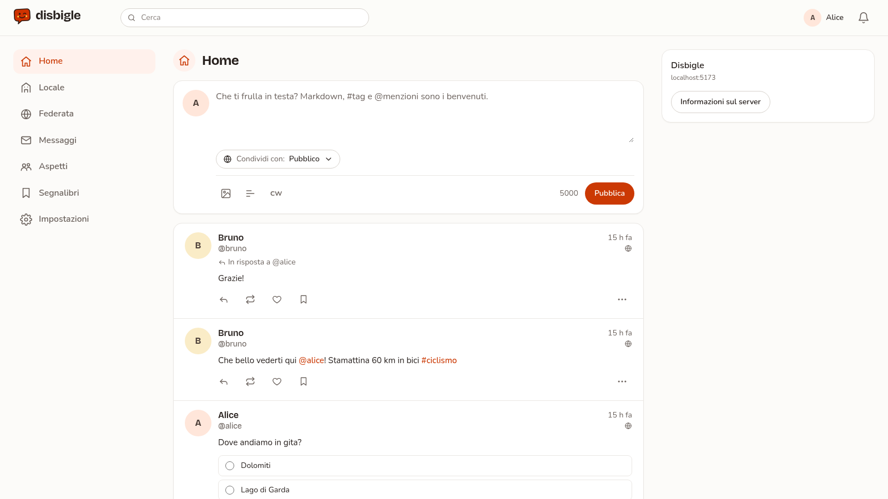
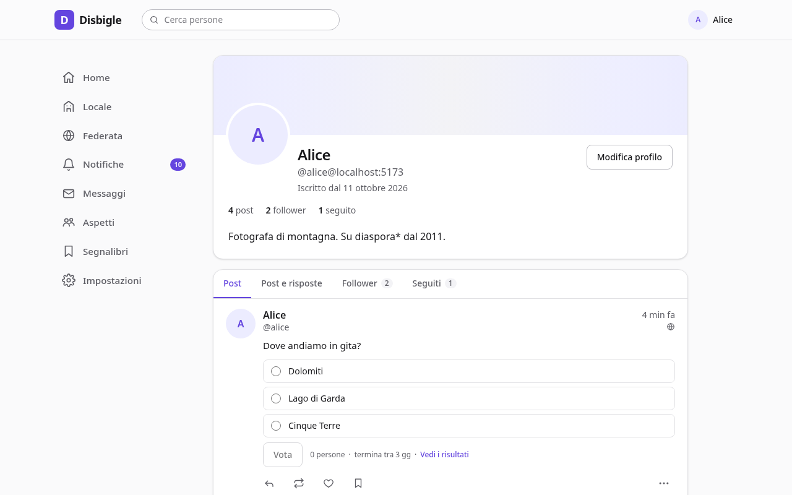
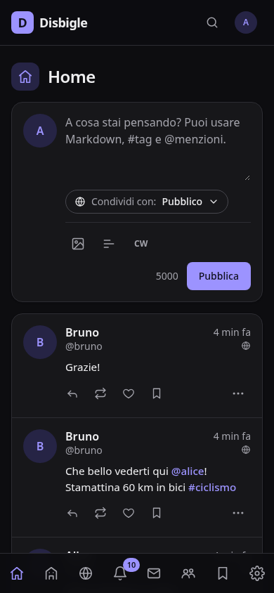

# Disbigle

A federated social network that speaks ActivityPub and stays compatible with the diaspora* network.

- **ActivityPub first**: follow and be followed from Mastodon, Misskey, Pixelfed and the rest of the Fediverse.
- **diaspora\* compatible**: talk to existing diaspora pods, and migrate a pod in place without losing identities.
- **Aspects**: share with the people you choose (family, friends, work…), not only "public" or "followers".

## Features

- **Accounts**: registration (open, approval, invite-only, closed), passkeys, two-factor authentication, password reset, data export, account deletion and moves between servers.
- **Sharing**: posts in Markdown with media, content warnings, polls and hashtags; five audiences (public, unlisted, followers, aspects, direct); replies, reshares, likes, bookmarks, edits; private conversations.
- **Timelines**: home, local, federated, hashtags (followable), aspects, bookmarks; live updates over WebSocket; notifications, including Web Push.
- **Federation**: ActivityPub (Mastodon, Misskey, Pixelfed, Lemmy…) and the diaspora\* protocol (diaspora, Friendica, Hubzilla); one account record per person even when they speak both.
- **One conversation across networks**: comments, likes and deletions made on diaspora\* reach Mastodon and the rest of the Fediverse, and the other way round, on public threads and on private ones (only among the people they were shared with), through clearly labelled bridge accounts (`user_at_domain@your.server`). Replies between ActivityPub servers are forwarded to your followers, as Mastodon does, and new followers on other servers get your latest public posts.
- **Migration**: import an existing diaspora\* pod on the same domain, keeping handles, keys and contacts.
- **Moderation**: approval queue, reports, suspensions, domain blocks, roles, audit log, editable instance settings and rules.
- **Privacy**: images stripped of metadata, remote media cached locally, visibility enforced in one place.
- **Apps**: the web client (English and Italian) installs as a PWA with push notifications; Mastodon apps (Tusky, Ivory, Elk, Phanpy…) work too, through a Mastodon-compatible API with OAuth 2. Mastodon lists are your aspects.

Status: early development. A test instance runs at [test.disbigle.com](https://test.disbigle.com) and federates with real diaspora\* pods, Hubzilla and Mastodon. See [docs/architettura.md](docs/architettura.md) (Italian) for the design, [docs/decisions.md](docs/decisions.md) for implementation decisions and [docs/deploy.md](docs/deploy.md) to run your own.

## Screenshots

| Home | Profile with a poll | Mobile, dark theme |
| --- | --- | --- |
|  |  |  |

## The name

*Disbigle* (Italian: *disbiglio*) is a made-up word. It was born when an angry father started to call his son *disgraziato*, changed his mind halfway through, and ended up with a brand new insult. Among friends it stuck as a fond way to tell someone they messed up.

## Development

Requirements: Node.js 22.18+, pnpm, PostgreSQL 16+ and Redis 7+.

```sh
pnpm install
cp .env.example .env          # adjust DATABASE_URL, REDIS_URL, SESSION_SECRET
pnpm db:migrate               # creates the database if needed and applies migrations
pnpm dev                      # API on :3000, web client on :5173, worker
```

Open http://localhost:5173. The first account registered becomes the administrator. `pnpm seed` adds demo accounts (alice, bruno, carla; password `disbigle-demo`).

Useful commands:

| Command | What it does |
| --- | --- |
| `pnpm test` | Unit and integration tests (needs PostgreSQL; set `TEST_DATABASE_URL` to a server where test databases can be created) |
| `pnpm typecheck` | Type checks every package |
| `pnpm lint` / `pnpm format` | Biome lint and format |
| `pnpm db:generate` | Generates a migration after editing `packages/db/src/schema.ts` |

## Layout

| Path | Contents |
| --- | --- |
| `apps/server` | HTTP API, WebSocket streaming, federation endpoints |
| `apps/worker` | Federation delivery queue and maintenance jobs |
| `apps/web` | React web client |
| `packages/core` | Domain logic: accounts, posts, aspects, visibility, timelines |
| `packages/db` | Database schema and migrations |
| `packages/activitypub` | ActivityPub adapter (Fedify) |
| `packages/diaspora` | diaspora\* protocol implementation |
| `packages/diaspora-bridge` | diaspora\* federation: discovery, delivery queue, incoming entities, bridge identities |
| `packages/diaspora-import` | In-place migration of a diaspora\* pod |
| `packages/mastodon-api` | Mastodon-compatible client API and OAuth 2 |
| `packages/shared` | API types and schemas shared with the client |
| `packages/config` | Typed configuration |

## License

[GNU Affero General Public License v3.0](LICENSE)
