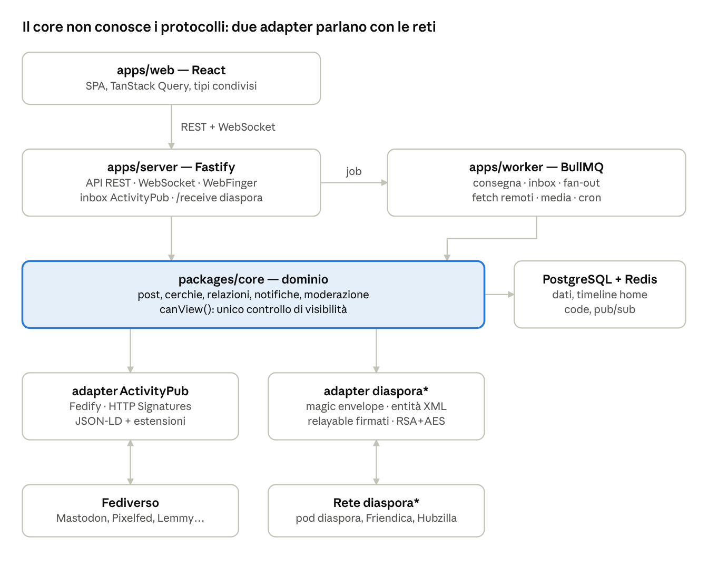
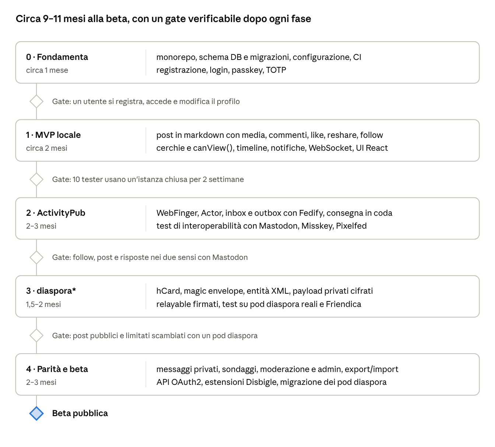

# Architettura — Disbigle

10 ottobre 2026

## Visione e principi

Un social federato e auto-ospitabile, scritto in TypeScript, che parla **ActivityPub come protocollo primario** e resta **compatibile con la rete diaspora**\*. Si distingue per la privacy granulare: si condivide con cerchie scelte, non solo "pubblico" o "follower".

Principi di progetto:

1. **Core neutrale rispetto al protocollo.** Il dominio non conosce né ActivityPub né diaspora; i protocolli sono adapter intercambiabili.
2. **Privacy prima di tutto.** La visibilità è un dato di prima classe su ogni oggetto, non un filtro aggiunto dopo.
3. **Facile da ospitare.** Solo Node, PostgreSQL e Redis; niente Docker per ora; una piccola VPS deve bastare per un'istanza di poche centinaia di utenti.
4. **Portabilità.** Export/import e migrazione dell'account, come in diaspora e Mastodon.
5. **Moderazione fin dal giorno uno.** Report, blocchi di utenti e di istanze, limiti di frequenza.

### Il nome: Disbigle

Il progetto si chiama **Disbigle**, versione internazionale di *disbiglio*: una parola inventata, nata da un padre arrabbiato che aveva cominciato a dire "disgraziato" e a metà ha cambiato insulto. Tra amici è rimasta come presa in giro affettuosa per chi combina un guaio.

- Si legge "dis-BI-gol"; *disbiglio* resta il nome affettuoso nella comunità italiana.
- Il suono iniziale "dis-" richiama *diaspora*, senza usare marchi altrui.
- Al 2026-10-11 nessun uso sul web; nomi liberi su GitHub e npm; disbigle.com, .org, .net e .social risultano non registrati. Da registrare subito almeno .org e .social.
- La storia del nome va nel README e nella pagina About.

## Stack e monorepo

Un solo monorepo TypeScript (pnpm workspaces + Turborepo) in cui backend e frontend condividono tipi e schemi di validazione.

| Livello | Scelta | Motivo |
| --- | --- | --- |
| Runtime | Node.js 22 LTS | Stabile, compatibile con Fedify e BullMQ |
| HTTP | Fastify | Veloce, schemi JSON nativi, plugin maturi |
| Validazione | Zod | Schemi condivisi tra API e frontend |
| ORM / migrazioni | Drizzle + drizzle-kit | Tipizzato, SQL trasparente, migrazioni versionate |
| Database | PostgreSQL 16+ | Full-text, JSONB, partial index |
| Code e cache | Redis + BullMQ | Consegna federata con retry e backoff |
| ActivityPub | Fedify | WebFinger, HTTP Signatures, inbox/outbox, NodeInfo |
| diaspora\* | Modulo proprio `@pkg/diaspora` | Nessuna libreria TS esistente |
| Auth | Sessioni + passkey (WebAuthn), TOTP, OAuth2/OIDC per le app | Standard moderni |
| Media | sharp per immagini, storage locale o S3 | Miniature e blurhash |
| Frontend | React 19 + Vite, TanStack Router e Query | SPA veloce, cache lato client |
| UI | Tailwind CSS + Radix UI | Accessibile, tema chiaro/scuro |
| Realtime | WebSocket (`@fastify/websocket`) + Redis pub/sub | Notifiche e timeline live |
| Test | Vitest + Playwright | Unit, integrazione, end-to-end |

Struttura delle cartelle:

```
disbigle/
  apps/
    server/        API REST, inbox/outbox, WebSocket
    worker/        processi BullMQ (consegna, media, fetch remoti)
    web/           React SPA
  packages/
    core/          dominio: entità, servizi, regole di visibilità
    db/            schema Drizzle, migrazioni, repository
    activitypub/   adapter ActivityPub (su Fedify)
    diaspora/      adapter diaspora: envelope, entità XML, firme
    shared/        tipi e schemi Zod condivisi con il frontend
    config/        configurazione tipizzata
```

`server` e `worker` usano lo stesso codice; in produzione girano come processi separati, in sviluppo anche in un solo processo.

## Architettura a livelli

Il core di dominio è il centro: API e worker lo chiamano, e solo i due adapter traducono da e verso i protocolli federati.



In ricezione la richiesta arriva al server, l'adapter la verifica e la traduce, il core la applica. In uscita il core emette un evento di dominio, il worker sceglie il protocollo per ogni destinatario e chiama l'adapter giusto. Aggiungere un terzo protocollo significa scrivere un terzo adapter, senza toccare il core.

## Modello dati

Circa 30 tabelle nel nucleo iniziale: il dominio di diaspora (aspects, condivisioni mirate) con lo schema degli account di Mastodon, che tratta utenti locali e remoti in un'unica tabella.

Regole generali:

- **Chiavi primarie:** `bigint` ordinabili nel tempo (stile Snowflake, come `timestamp_id` di Mastodon): paginazione semplice e nessuna collisione tra worker.
- **Doppia identità federata:** ogni oggetto federabile ha `ap_uri` (URI ActivityPub) e `diaspora_guid` (GUID diaspora), entrambi univoci e nullable. Gli oggetti locali li generano entrambi alla creazione.
- **Locale e remoto nella stessa tabella:** `domain IS NULL` = locale, come in Mastodon.
- **Visibilità su ogni contenuto**, vedi la sezione Aspects.
- Cancellazioni federate tramite **tombstone**, per non far rinascere oggetti eliminati.

| Area | Tabelle | Origine |
| --- | --- | --- |
| Account | `actors` (locali e remoti, chiavi pubbliche, inbox, protocolli supportati), `users` (credenziali, solo locali), `profiles`, `keypairs`, `webauthn_credentials` | Mastodon `accounts`/`users`, diaspora `people`/`profiles` |
| Relazioni | `follows`, `follow_requests`, `blocks`, `mutes`, `domain_blocks` | Mastodon |
| Cerchie | `aspects`, `aspect_memberships` | diaspora |
| Contenuti | `posts` (status, reshare, reply), `post_edits`, `media_attachments`, `polls`, `poll_votes`, `mentions`, `tags`, `post_tags`, `preview_cards` | entrambi |
| Visibilità | `post_audiences` (destinatari espliciti: aspect, attore, pubblico) | diaspora `share_visibilities`/`aspect_visibilities` |
| Interazioni | `likes`, `bookmarks`, `relayable_signatures` | diaspora `*_signatures` |
| Messaggi privati | `conversations`, `conversation_participants`, `messages` | diaspora |
| Notifiche | `notifications`, `web_push_subscriptions` | Mastodon |
| Federazione | `instances` (software, protocolli, stato, ultimo errore), `delivery_failures`, `tombstones` | diaspora `pods`, Mastodon `unavailable_domains` |
| Moderazione | `reports`, `report_notes`, `admin_action_logs`, `ip_blocks`, `email_domain_blocks` | Mastodon |
| App e API | `oauth_applications`, `oauth_tokens` | entrambi |
| Portabilità | `account_aliases`, `account_migrations`, `exports` | entrambi |

Campi chiave di `actors`:

| Campo | Tipo | Uso |
| --- | --- | --- |
| `username`, `domain` | text | handle `utente@dominio`; univoco su `lower()` |
| `ap_uri`, `ap_inbox`, `ap_shared_inbox` | text | endpoint ActivityPub |
| `diaspora_guid`, `diaspora_receive_url` | text | endpoint diaspora |
| `public_key_pem` | text | RSA 4096, condivisa dai due protocolli |
| `protocols` | text\[\] | `{activitypub, diaspora}` rilevati con WebFinger |
| `preferred_protocol` | enum | protocollo scelto per la consegna |
| `last_fetched_at` | timestamptz | refresh periodico del profilo |

## Identità, chiavi e discovery

Ogni utente ha un solo handle `utente@dominio` e una sola coppia di chiavi RSA 4096, pubblicata in entrambi i formati: un server ActivityPub e un pod diaspora lo trovano con lo stesso WebFinger.

| Endpoint | Protocollo | Contenuto |
| --- | --- | --- |
| `/.well-known/webfinger` | entrambi | JRD con `self` (ActivityPub), `profile-page`, `http://microformats.org/profile/hcard`, `http://joindiaspora.com/seed_location`, `salmon` |
| `/.well-known/host-meta` | diaspora | XRD che rimanda al WebFinger (richiesto dai pod più vecchi) |
| `/.well-known/nodeinfo` + `/nodeinfo/2.1` | entrambi | `protocols: ["activitypub", "diaspora"]` |
| `/users/:username` | ActivityPub | Actor JSON-LD con `publicKey`, `inbox`, `outbox`, `followers` |
| `/hcard/users/:guid` | diaspora | hCard con chiave pubblica, nome, avatar |
| `/inbox`, `/users/:username/inbox` | ActivityPub | ricezione con HTTP Signatures |
| `/receive/public`, `/receive/users/:guid` | diaspora | magic envelope pubblici e privati |
| `/fetch/:type/:guid` | diaspora | recupero di un singolo oggetto firmato |

Scoperta di un utente remoto:

1. WebFinger sull'handle.
2. Se c'è il link `self` di tipo `application/activity+json` → si scarica l'Actor e si registra `activitypub`.
3. Se c'è il link hcard/seed → si scarica la hCard e si registra `diaspora`.
4. `preferred_protocol` = ActivityPub se disponibile, altrimenti diaspora.
5. Profilo e chiavi si aggiornano ogni 24 ore, oppure subito dopo un errore di firma.

Aspetti da curare:

- **Rotazione delle chiavi:** diaspora non ha un meccanismo standard; si rimanda alla migrazione dell'account.
- **Firme:** HTTP Signatures (draft-cavage) e RFC 9421 per ActivityPub, gestite da Fedify; RSA-SHA256 su magic envelope per diaspora.
- **Account remoti che parlano entrambi** (Friendica, Hubzilla): un solo record `actors`, mai due, deduplicato su handle.

## Mappatura diaspora ↔ ActivityPub

Quasi tutte le entità diaspora hanno un equivalente diretto in ActivityPub; le differenze vere sono tre: firme dei relayable, messaggi privati e semantica di `Contact`.

| Core | diaspora\* | ActivityPub | Note |
| --- | --- | --- | --- |
| Post | `StatusMessage` (+ `Photo`, `Poll`, `Location`) | `Create` + `Note` (`Question` se sondaggio) | Markdown nel core; HTML per AP, markdown nativo per diaspora |
| Reshare | `Reshare` | `Announce` |  |
| Commento | `Comment` (relayable) | `Create` + `Note` con `inReplyTo` | diaspora: niente thread annidati, si appiattisce |
| Like | `Like` (`positive=true`) | `Like` | `positive=false` di diaspora non ha equivalente: ignorato |
| Voto | `PollParticipation` (relayable) | `Create` + `Note` con `name` = opzione | Convenzione di Mastodon |
| Follow | `Contact` (`sharing`/`following`) | `Follow` / `Accept` / `Undo` | diaspora: condivisione asimmetrica senza richiesta da accettare |
| Blocco | `Contact` con `blocking=true` | `Block` |  |
| Profilo | `Profile` | `Update` + `Person` |  |
| Messaggio privato | `Conversation` + `Message` | `Create` + `Note` con destinatari solo in `to` | AP non ha conversazioni vere; si raggruppa per `context` |
| Cancellazione | `Retraction` | `Delete` (+ `Tombstone`) |  |
| Annulla like/reshare | `Retraction` | `Undo` |  |
| Migrazione | `AccountMigration` | `Move` |  |
| Eliminazione account | `AccountDeletion` | `Delete` sull'Actor |  |
| Partecipazione | `Participation` | nessuno | Solo interno: per seguire le notifiche di un post |
| Modifica post | non supportata | `Update` + `Note` | Verso diaspora non si propaga |

**Relayable.** In diaspora commenti, like e voti sono firmati dall'autore e poi **rilanciati dal proprietario del post** a tutti i destinatari, con l'ordine originale delle proprietà da preservare. ActivityPub fa lo stesso con l'inoltro dell'inbox (Mastodon `forwarder.rb`). Il core quindi tratta l'inoltro come un unico concetto: quando un'interazione arriva su un post locale, si rilancia a tutto il pubblico del post, in entrambi i protocolli. Le firme originali stanno in `relayable_signatures`.

**Scelta del protocollo per ogni consegna:**

1. Si raccolgono i destinatari (attori, follower, membri degli aspect).
2. Si raggruppano per istanza e per `preferred_protocol`.
3. ActivityPub: un job per shared inbox. diaspora: un job per pod (pubblico) o per destinatario (privato, payload cifrato).
4. Un post pubblico raggiunge così utenti diaspora e Mastodon nello stesso istante.

## Migrazione in loco di un pod diaspora

Un admin può passare da diaspora a Disbigle sullo stesso dominio senza perdere nulla: handle, chiavi RSA e GUID restano identici, quindi i contatti remoti non si accorgono del cambio. È il motivo più forte per cui un pod diaspora esistente dovrebbe adottare il progetto.

1. Il pod diaspora passa in sola lettura e si fa un backup.
2. `disbigle import-diaspora` legge il database di diaspora (PostgreSQL o MySQL) e importa utenti, `people`, profili, chiavi private, contatti, aspects, post, foto, commenti, like, sondaggi e conversazioni.
3. Le password restano valide: si accettano gli hash bcrypt di Devise (con il pepper di diaspora) e si convertono in Argon2id al primo login.
4. I file caricati si copiano o restano nello stesso bucket S3.
5. I vecchi URL (`/posts/:id`, `/u/:username`, `/people/:guid`) vengono reindirizzati ai nuovi.
6. Al primo avvio ogni utente diventa anche un attore ActivityPub con la stessa chiave: i contatti diaspora continuano a funzionare e l'account diventa seguibile da Mastodon.

Il modello dati lo prevede già (`diaspora_guid`, chiave RSA condivisa, `relayable_signatures`). Primo caso reale: diaspo.it; hubzilla.diaspo.it come banco di prova per l'interoperabilità. Lo strumento si sviluppa insieme all'adapter diaspora e si rilascia con la beta.

## Aspects e visibilità

Un post ha uno di cinque livelli di visibilità; il livello "Cerchie" si traduce in destinatari espliciti, che entrambi i protocolli sanno rispettare tra istanze compatibili.

| Livello | Chi lo vede | ActivityPub | diaspora\* |
| --- | --- | --- | --- |
| Pubblico | Tutti, anche nelle timeline pubbliche | `to: Public` | `public=true` |
| Non in elenco | Tutti con il link, fuori dalle timeline | `cc: Public` | `public=true` (diaspora non distingue) |
| Follower | Chi mi segue | `to: followers` | privato a tutti i contatti con cui condivido |
| Cerchie | Membri di uno o più aspect | `to:` elenco esplicito di attori | privato, envelope cifrato per ciascun destinatario |
| Diretto | Solo le persone menzionate | `to:` solo menzionati | `Conversation` |

Regole:

- Gli aspect sono **privati del proprietario**: il destinatario non sa in quale cerchia è stato messo, e il nome dell'aspect non esce mai dal server.
- Al momento della pubblicazione gli aspect vengono **risolti in un elenco di attori** salvato in `post_audiences`. Chi entra in una cerchia dopo non vede i post precedenti, come in diaspora.
- I controlli di accesso stanno in un solo punto del core (`canView(viewer, post)`), usato da API, timeline, WebSocket e fetch federato.
- Le risposte a un post limitato ereditano lo stesso pubblico.

**Limite noto:** verso Mastodon e altri software ActivityPub la privacy è "best effort". Un server remoto può mostrare il post a chi vuole; i reshare dei post non pubblici sono bloccati solo lato nostro. Va spiegato chiaramente nell'interfaccia.

## Code, consegna federata e realtime

Tutto il lavoro di rete esce dalla richiesta HTTP e passa da code BullMQ su Redis; il client riceve gli aggiornamenti via WebSocket alimentato da Redis pub/sub.

| Coda | Lavoro | Retry |
| --- | --- | --- |
| `deliver-ap` | POST firmato a un inbox ActivityPub | backoff esponenziale, circa 8 tentativi in 2 giorni |
| `deliver-diaspora` | POST di un magic envelope a un pod | come sopra |
| `inbox` | verifica firma, parsing, applicazione al core | 3 tentativi, poi coda errori |
| `fanout` | inserimento nelle timeline locali e notifiche | breve |
| `fetch` | risoluzione di attori, post, thread remoti | con cache negativa |
| `media` | miniature, blurhash, download di media remoti | breve |
| `scheduled` | pulizie, refresh profili, controllo istanze | cron |

Regole di consegna:

- Un'istanza che fallisce per 7 giorni viene marcata **non disponibile** e saltata, poi ricontrollata ogni giorno (come `unavailable_domains` di Mastodon e `pods` di diaspora).
- La consegna è **idempotente**: chi riceve deduplica su `ap_uri` / `diaspora_guid`.
- Le inbox rispondono `202` subito e lavorano in coda: nessun timeout verso server remoti lenti.

Timeline:

- **Home** materializzata in Redis per gli utenti attivi (fan-out in scrittura, come Mastodon), ricostruita da PostgreSQL per gli altri.
- **Pubblica locale, federata, per tag, per aspect:** query su PostgreSQL con indici dedicati.

Realtime:

- Un endpoint `/api/v1/streaming` su WebSocket, autenticato con il token di sessione.
- Canali: `user` (home e notifiche), `aspect:<id>`, `public`, `public:local`, `tag:<nome>`, `conversation:<id>`.
- Il worker pubblica eventi su Redis pub/sub; ogni processo server li inoltra ai propri socket. Si scala orizzontalmente senza stato condiviso.
- Eventi tipizzati nel pacchetto `shared` e usati direttamente dal frontend React.

## Sicurezza, moderazione e privacy

Ogni dato in ingresso dalla federazione è ostile finché non è verificato: firma valida, autore coerente con il dominio, contenuto sanificato.

**Federazione**

- Firma obbligatoria su ogni messaggio in arrivo; l'autore dell'oggetto deve appartenere al dominio che firma.
- Protezione SSRF sui fetch remoti: niente IP privati, limiti di dimensione e di tempo, redirect contati.
- HTML remoto sanificato con allowlist di tag; markdown diaspora renderizzato e poi sanificato.
- Limiti di frequenza per istanza sulle inbox.

**Account**

- Password con Argon2id, passkey WebAuthn, TOTP come secondo fattore.
- Sessioni in cookie `HttpOnly` + `SameSite`; token OAuth2 con scope per le app.
- Rate limiting su login, registrazione, reset password (Redis).

**Moderazione**

- Report su post e account, inoltrabili all'istanza remota (`Flag` AP; diaspora non ha equivalente).
- Blocco e silenziamento di utenti e di interi domini, importabili da liste condivise.
- Registrazioni: aperte, su invito, su approvazione.
- Log delle azioni degli amministratori.

**Privacy e GDPR**

- Export completo dei dati (JSON compatibile con l'archivio diaspora e con il formato Mastodon dove possibile).
- Eliminazione dell'account propagata con `Delete` / `AccountDeletion`.
- Media dei post non pubblici serviti tramite URL firmati a scadenza, non pubblici.

## Un protocollo nuovo?

No, non come protocollo separato: nessun protocollo nuovo dà compatibilità con gli altri da solo, perché per parlare con Mastodon o diaspora bisogna comunque parlare ActivityPub e diaspora. Conviene invece **estendere ActivityPub**: i vantaggi si ottengono tra istanze Disbigle, e gli altri server ignorano i campi che non conoscono.

Cosa insegnano i precedenti:

| Progetto | Approccio | Esito |
| --- | --- | --- |
| Hubzilla / Streams | Protocollo proprio (Zot, poi Nomad) + adapter AP e diaspora | Funzioni avanzate (identità nomade, permessi fini), adozione molto piccola |
| Bluesky | Protocollo nuovo (AT Protocol) | Grande rete propria; verso il Fediverso serve un bridge esterno (Bridgy Fed) |
| Mastodon, Misskey, Pixelfed | ActivityPub + estensioni proprie | Interoperabilità ampia, estensioni adottate dagli altri nel tempo |

Un protocollo separato raddoppia il lavoro (un terzo adapter, una specifica da mantenere) e i vantaggi valgono solo tra istanze dello stesso software, cioè esattamente lo stesso risultato che si ottiene con le estensioni.

Estensioni proposte, in un namespace JSON-LD proprio e allineate alle FEP (Fediverse Enhancement Proposals) quando esistono:

| Estensione | Vantaggio | Comportamento verso server non Disbigle |
| --- | --- | --- |
| Pubblico con nome (cerchie) e divieto di reshare firmato | Privacy rispettata tra istanze Disbigle | Ricevono un normale post con destinatari espliciti |
| Firme sull'oggetto (FEP-8b32, già in Mastodon) | Post verificabili anche se inoltrati da terzi, come i relayable diaspora | Campo ignorato |
| Identità portabile (FEP-ef61 / chiavi dell'utente) | Migrazione dell'account senza perdere i follower | Fallback su `Move` |
| Messaggi diretti cifrati end-to-end (MLS) | Il server non legge i messaggi privati | Messaggio diretto normale o avviso "apri da Disbigle" |
| Modifica e cancellazione con versioni | Storia delle modifiche verificabile | `Update` standard |

Da riconsiderare solo se, a progetto avviato, emergesse un requisito che ActivityPub non può proprio esprimere.

## Roadmap e rischi

Cinque fasi in sequenza portano alla beta pubblica in circa 9–11 mesi con 1–2 sviluppatori; ogni fase si chiude solo quando il suo gate è verificato.



Le cerchie entrano già nella fase 1: la visibilità è nel modello dati fin dall'inizio, non aggiunta dopo. Le stime sono indicative e vanno ricalcolate alla fine della fase 1.

| Rischio | Impatto | Mitigazione |
| --- | --- | --- |
| Variazioni tra implementazioni ActivityPub | Alto | Test automatici contro istanze reali di Mastodon e Misskey in locale; casi presi dai fixture di Fedify |
| Protocollo diaspora poco documentato nei dettagli | Medio | Specifica ufficiale + test ricavati dalla gem `diaspora_federation` nel repo clonato |
| Rete diaspora in calo | Medio | Adapter isolato: si può rimandare o spegnere senza toccare il core |
| Spam e abusi dopo l'apertura | Alto | Moderazione nella fase 4 prima della beta; registrazioni su invito all'inizio |
| Privacy delle cerchie verso server terzi | Medio | Avviso chiaro nell'interfaccia; estensioni Disbigle tra istanze compatibili |
| Prestazioni delle timeline | Basso | Fan-out in Redis come Mastodon; indici dedicati in PostgreSQL |
